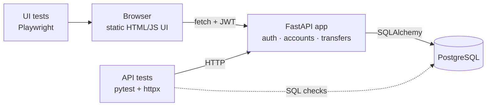

# FinGuard QA Automation Suite

[](https://github.com/AlmatUzakbayev/finguard-qa-automation/actions/workflows/ci.yml)

Automated API and UI testing of a small banking service — written in Python with
**pytest, httpx, Playwright, PostgreSQL and GitHub Actions**.

> **Self-study portfolio project, built with AI assistance.** FinGuard is a *training*
> application created specifically as a target for test automation. It is not a real bank,
> it is not certified, and it must never be used with real money or real personal data.

## What this repository shows

| | |
|---|---|
| **Project A — Banking API Automation** (main) | 43 test functions / **90 test cases**: functional, negative, boundary, database, idempotency, concurrency, contract |
| **Project B — Web UI Automation** | 10 test functions / **17 test cases** with Playwright + Page Object Model |
| **Bug found and fixed** | [BUG-001](docs/known_issues.md#bug-001--account-id-outside-the-integer-range-causes-http-500): HTTP 500 on out-of-range account ids — found by exploratory testing, reproduced by a failing test, fixed, kept as a regression test |
| **Tests verified to catch bugs** | 20 deliberately injected bugs (race condition, missing ownership check, off-by-one, non-atomic transfer…): 19 caught, 1 explained — see [Mutation check](#how-do-we-know-the-tests-work) |
| **Documentation** | [Test strategy](docs/test_strategy.md) · [Test plan](docs/test_plan.md) · [Test cases](docs/test_cases.md) · [Test report](docs/test_report.md) · [Known issues](docs/known_issues.md) |

## System under test



| Feature | Endpoint |
|---|---|
| Register / login (JWT) | `POST /api/auth/register`, `POST /api/auth/login` |
| Profile | `GET /api/users/me` |
| Accounts (KZT / USD / EUR) | `POST /api/accounts`, `GET /api/accounts`, `GET /api/accounts/{id}` |
| Balance | `GET /api/accounts/{id}/balance` |
| Top up (training only) | `POST /api/accounts/{id}/deposit` |
| Transfer (requires `Idempotency-Key`) | `POST /api/transfers` |
| History (paginated) | `GET /api/accounts/{id}/transactions?limit=&offset=` |

Interactive API docs: `http://localhost:8000/docs` once the app is running.

**Key engineering decisions** (each one is tested):
- Money is `NUMERIC(18,2)` in the DB, `Decimal` in Python and a string (`"100.00"`) in JSON — never float.
- A transfer locks both accounts with `SELECT … FOR UPDATE` in ascending id order: no lost updates, no deadlocks.
- `Idempotency-Key` header + a `UNIQUE(initiator_id, idempotency_key)` constraint: a retried transfer is never charged twice.
- `CHECK (balance >= 0)` in the database as the last line of defence.
- Another user's account answers `404`, exactly like a non-existent one (no account enumeration).

## Test coverage

| Category | What is checked | Where |
|---|---|---|
| Functional | Register, login, accounts, deposit, transfer, history, pagination | `tests/api/test_auth.py`, `test_accounts.py`, `test_transfers.py` |
| Negative | Wrong password, missing / malformed / **expired** / forged token, negative and zero amounts, insufficient funds, unknown account, **someone else's account** | same files |
| Boundary | `0.01`, amount = balance, balance + 0.01, `1 000 000.00`, `1 000 000.01`, password 7/8/128/129 | `tests/api/test_boundaries.py` |
| Database | Exact stored values, no rows after a failed transfer, **atomicity under an injected crash**, CHECK constraints, ledger reconciliation | `tests/api/test_database.py` |
| Idempotency & concurrency | Replay of the same key, conflicting key, 10 parallel retries → one debit, 10 parallel transfers → no overdraft, A→B / B→A → no deadlock | `tests/api/test_idempotency_and_concurrency.py` |
| Contract | Strict JSON schemas for every response, uniform error format, HTTP status codes | `tests/api/test_contract.py` |
| UI | Login, wrong password, protected pages, logout, balances, open account + top up, transfer, form validation errors, double-click, history | `tests/ui/` |

Concurrency tests are **deterministic**: all threads start together on a `threading.Barrier`, and the
assertions are invariants that hold for any interleaving ("exactly 3 of 10 succeed"), so they do not
depend on timing and contain no `sleep()`.

## Results

Last local run — 2026-10-23, Windows 10, Python 3.14, PostgreSQL 16.4, Chromium (Playwright 1.64):

| Suite | Result | Duration |
|---|---|---|
| API (`tests/api`) | **90 passed**, 0 failed | — |
| UI (`tests/ui`) | **17 passed**, 0 failed | — |
| Full run (`tests`), twice in a row | **107 passed**, 0 failed — both runs | 3 min 02 s / 2 min 32 s |
| Ruff (lint + format) | no issues | — |

Details, including the first run where the BUG-001 tests failed, are in [docs/test_report.md](docs/test_report.md).

**CI status:** the GitHub Actions workflow ([.github/workflows/ci.yml](.github/workflows/ci.yml)) is written
but **has not run yet** — it runs on the first push to GitHub. Docker Compose was also not executed on the
development machine (Docker is not installed there); the tests ran against a locally installed PostgreSQL.

## How do we know the tests work?

A test that never fails proves nothing. Twenty realistic bugs were injected into the application one at a time,
and the relevant tests were run against each of them. Examples:

| Injected bug | Caught by | What the test saw |
|---|---|---|
| `SELECT … FOR UPDATE` removed | `test_parallel_transfers_never_overdraw_the_account` | `{201: 10}` — all ten 30.00 transfers succeeded against a balance of 100.00 |
| Idempotency key not stored | `test_parallel_retries_with_same_key_debit_only_once` | `{201: 2, 422: 8}` — the customer was charged twice |
| Source-account ownership check removed | `test_cannot_transfer_from_someone_elses_account` | `201` — money stolen from another user |
| `balance < amount` changed to `<=` | `test_transfer_amount_boundaries[amount-equals-balance]` | full-balance transfer rejected |
| Commit after the debit (non-atomic) | `test_transfer_is_rolled_back_completely_if_it_fails_midway` | debit survived the crash |
| Expired tokens accepted | `test_profile_rejects_missing_or_invalid_token[expired-token]` | `200` instead of `401` |
| `password_hash` added to the user response | `test_successful_responses_match_contract` | `Extra inputs are not permitted` |

The one surviving mutant (the UI "Send" button no longer disabled during the request) is covered by a second
safeguard — the form's idempotency key — so the user is still charged once. Removing both safeguards makes the
test fail. Full table: [docs/test_report.md](docs/test_report.md#mutation-check).

## Run it yourself

Prerequisites: Python 3.12+, and either Docker or a local PostgreSQL 16.

```bash
# 1. Get the code and install dependencies
python -m venv .venv
source .venv/bin/activate            # Windows: .venv\Scripts\activate
pip install -e ".[test]"
python -m playwright install chromium

# 2. Start PostgreSQL (creates the databases "finguard" and "finguard_test")
docker compose up -d db
#    ...or use your own PostgreSQL and create both databases, then set
#    TEST_DATABASE_URL / DATABASE_URL (see .env.example)

# 3. Run the tests — migrations and the app server are started automatically
pytest tests/api                     # API tests
pytest tests/ui                      # UI tests (headless Chromium)
pytest tests/ui --headed --slowmo 500  # watch the browser
pytest -m "smoke"                    # only the critical path
pytest -m "concurrency or db"        # by category (see markers in pyproject.toml)

# 4. Reports
pytest tests --html=reports/report.html --self-contained-html --junitxml=reports/junit.xml
#    On failure, Playwright screenshots and traces go to reports/playwright/
#    Open a trace: python -m playwright show-trace reports/playwright/<test>/trace.zip

# 5. Lint
ruff check . && ruff format --check .
```

Run the application manually:

```bash
docker compose up -d --build         # app + DB → http://localhost:8000
# or, with the DB already running:
alembic upgrade head
uvicorn app.main:app --reload        # http://127.0.0.1:8000
```

Run the tests against an already running server: `API_BASE_URL=http://localhost:8000 pytest tests/api`
(the server's `JWT_SECRET` must match the tests' `JWT_SECRET` for the expired-token test).

## Repository structure

```
app/                  FastAPI application (system under test)
  main.py             app, routers, static UI
  services.py         transfer logic: locking, idempotency, atomicity
  models.py           SQLAlchemy models + DB constraints
  schemas.py          request/response validation (Pydantic)
alembic/              database migrations
frontend/             minimal web UI (HTML + vanilla JS, no build step)
tests/
  conftest.py         starts DB migrations + server, user/account factories
  support/            API client, DB inspector, contract schemas, assertions
  api/                Project A — API tests
  ui/                 Project B — Playwright tests + page objects
docs/                 test strategy, plan, cases, report, known issues
learning/             study materials in Russian (for the author)
.github/workflows/    CI pipeline
docker-compose.yml    PostgreSQL + app for local runs
```

## Known limitations

See [docs/known_issues.md](docs/known_issues.md): no token revocation on logout, the deposit endpoint is a
training shortcut, Chromium only, CI not yet executed, and more.

## About

Built as a self-study project to practise QA automation for Junior QA Automation / API QA roles.
The application and tests were developed with the help of an AI assistant; every test was run,
reviewed and checked for its ability to catch bugs. No commercial experience is implied.
